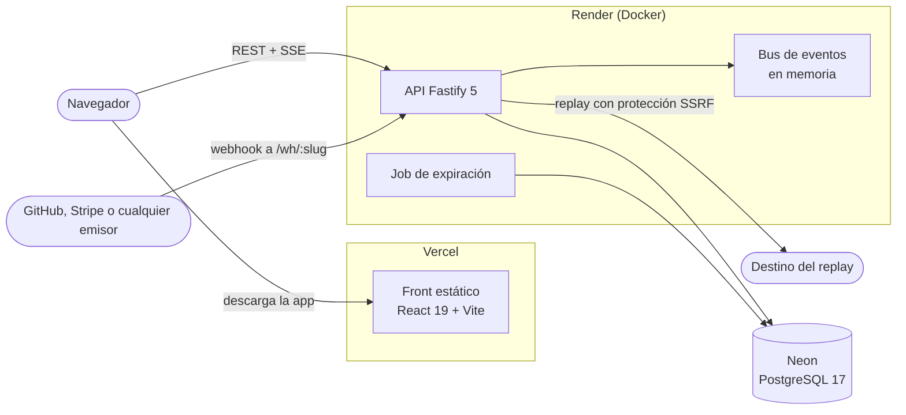
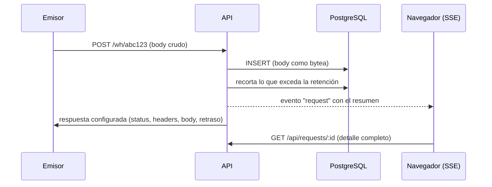

# HookLens

[](https://github.com/JesusC1755/HookLens/actions/workflows/ci.yml)

Inspector y depurador de webhooks para cualquier proveedor. Genera una URL única, recibe cualquier
request HTTP, la guarda **byte a byte tal como llegó** y te deja inspeccionarla en vivo, compararla con
otra y reenviarla a tu aplicación.

**Demo:** [hook-lens-eta.vercel.app](https://hook-lens-eta.vercel.app). No hace falta cuenta; cada endpoint dura 7 días.

<!-- GIF del demo: graba docs/demo.gif y reemplaza esta línea por  -->

## Qué hace

- **Captura cualquier request** en `/wh/:slug` y sus subrutas, con cualquier método, content-type o
  body binario, hasta 1 MB. Incluso un `Content-Type` malformado, que otros servidores rechazan con 415.
- **Lista en vivo** por Server-Sent Events: cada webhook aparece al instante, sin recargar.
- **Visor de body** formateado (JSON y XML), como texto o como hexdump. Puedes copiarlo, descargarlo
  o copiar la request completa como cURL.
- **Búsqueda y filtros** por método, texto (en path, query, headers y body) y header (presencia o
  valor exacto).
- **Diff entre dos requests**, con normalización de JSON para que el orden de las claves no cuente
  como cambio.
- **Replay** de una request a tu aplicación: idéntica a la original o editada antes de enviarla, con
  historial de respuestas.
- **Respuesta personalizada** del endpoint (status, headers, body y un retraso de hasta 10 s), para
  probar cómo reacciona el emisor ante errores o timeouts.

## Arquitectura



Así viaja un webhook:



## Decisiones técnicas

| Decisión                                                                                  | Por qué                                                                                                                                                                                                                                                                      |
| ----------------------------------------------------------------------------------------- | ---------------------------------------------------------------------------------------------------------------------------------------------------------------------------------------------------------------------------------------------------------------------------- |
| **El body se guarda crudo en `bytea`** y solo se formatea al mostrarlo                    | Las firmas HMAC (GitHub, Stripe) se calculan sobre los bytes exactos. Pasarlo por UTF-8 o por un parser JSON lo alteraría, y el replay ya no sería idéntico.                                                                                                                 |
| **Parser de content-type comodín** en la ingesta, que entrega un `Buffer` sin interpretar | Un inspector debe capturar justo las requests "raras": sin content-type, binarias o malformadas.                                                                                                                                                                             |
| **Token del dueño hasheado** (SHA-256) y guardado en `localStorage`                       | Sin cuentas: la ingesta es pública y la gestión exige el token. Si se filtra la base, los tokens no sirven. Basta SHA-256 sin bcrypt porque el token es aleatorio de 256 bits, no una contraseña.                                                                            |
| **IDs `uuid`, paginación por cursor** `(received_at, id)`                                 | Los IDs no se pueden enumerar, y el cursor no salta ni duplica filas mientras llegan webhooks en vivo (OFFSET sí lo haría).                                                                                                                                                  |
| **SSE con `fetch` y no `EventSource`**                                                    | `EventSource` no permite enviar el header `Authorization`, y el token no debe ir en la URL, donde queda en logs. El cliente implementa reconexión con backoff exponencial y jitter, y un watchdog de inactividad.                                                            |
| **SSRF validado dentro del `lookup` del socket**                                          | Se validan todas las IPs que resuelve el DNS justo antes de conectar, lo que cierra el ataque de _DNS rebinding_. Se bloquean redes privadas, loopback, link-local (incluida la de metadatos de la nube, `169.254.169.254`) y rangos reservados. No se siguen redirecciones. |
| **Rate limit por capas**                                                                  | Crear endpoints: 10 por hora por IP. Ingesta: 120 por minuto por slug, porque los emisores comparten IPs. Replay: 30 por minuto por token. Un solo limitador cubre `/wh/:slug` y sus subrutas, así no se duplica el cupo.                                                    |
| **IP real del cliente detrás de Cloudflare y Render**                                     | `TRUST_PROXY` lista los proxies de confianza (loopback, la red interna y los rangos oficiales de Cloudflare). `X-Forwarded-For` se recorre desde la derecha, así que una IP falsa enviada por el cliente se ignora.                                                          |
| **Retención y expiración**                                                                | Cada endpoint guarda sus últimas N requests y M MB (la que se cumpla primero, con funciones de ventana). Un job borra los endpoints vencidos por lotes, con un `pg_try_advisory_xact_lock` para que con varias instancias trabaje solo una.                                  |
| **CSP estricta en dos capas**                                                             | El front no permite scripts inline y solo se conecta a su propio API. La CSP se genera en el build a partir de `VITE_API_URL`. Las respuestas de la ingesta llevan `CSP: sandbox`, para que una URL de webhook no pueda servir una página maliciosa en el dominio del API.   |
| **Liveness y readiness separados**                                                        | `/health/live` no toca la base: el monitor que mantiene despierto el servicio no impide que Postgres se suspenda. `/health` sí la consulta, para diagnóstico.                                                                                                                |

### Límites conocidos

- **Una sola instancia del API:** el bus de eventos y los contadores del rate limit viven en memoria.
  Para escalar horizontalmente, el bus pasaría a Redis pub/sub o `LISTEN/NOTIFY` (ya está detrás de
  una interfaz `PubSub`) y el rate limit a Redis (el plugin lo admite sin más cambios).
- **Sin cuentas:** el acceso a un endpoint vive en el navegador que lo creó.
- **La búsqueda en el body distingue mayúsculas**, porque compara bytes. Así funciona igual con
  bodies que no son texto.

## Stack

- **API:** Node 22, Fastify 5, TypeScript estricto, Drizzle ORM, PostgreSQL 17, Zod, Vitest.
- **Web:** React 19, Vite, TanStack Query, Tailwind CSS 4, jsdiff.
- **Infraestructura:** monorepo pnpm, Docker multi-stage, GitHub Actions, Render, Neon y Vercel.

Los tests de integración del API corren contra un **Postgres real**, porque bytea, JSONB, funciones de
ventana y advisory locks no se pueden simular con un mock. El CI levanta Postgres como servicio en cada
push.

## Desarrollo local

Requisitos: Node ≥ 22.12, pnpm 12 y Docker.

```bash
pnpm install
cp .env.example .env
cp apps/web/.env.example apps/web/.env
pnpm db:up        # Postgres 17 en Docker (crea hooklens y hooklens_test)
pnpm db:migrate
pnpm dev          # API en :3001, web en :5173
```

Prueba la ingesta (copia la URL del endpoint desde la app):

```bash
curl -X POST 'http://localhost:3001/wh/TU-SLUG/pedidos?origen=local' \
  -H 'content-type: application/json' -d '{"pedido":42}'
```

Chequeos (los mismos que corre el CI):

```bash
pnpm format:check && pnpm lint && pnpm typecheck
pnpm test         # incluye los tests de integración contra hooklens_test
pnpm build
```

Para reenviar requests a una app en tu máquina, pon `REPLAY_ALLOW_LOOPBACK=true` en `.env`. Solo
funciona en desarrollo: con `NODE_ENV=production`, el API se niega a arrancar con esa opción activa.

## Despliegue

| Pieza         | Dónde                          | Configuración                                                                                    |
| ------------- | ------------------------------ | ------------------------------------------------------------------------------------------------ |
| API           | Render, Web Service con Docker | Dockerfile `./apps/api/Dockerfile`, contexto `.` (la raíz del repo), health check `/health/live` |
| Base de datos | Neon                           | Conexión directa (sin pooler), con `sslmode=verify-full`                                         |
| Front         | Vercel                         | Root directory `apps/web`, preset Vite                                                           |

El contenedor aplica las migraciones al arrancar y luego inicia el servidor como PID 1, para que el
cierre ante SIGTERM sea ordenado.

### Variables de entorno del API

| Variable                      | Ejemplo en producción                       | Descripción                                                 |
| ----------------------------- | ------------------------------------------- | ----------------------------------------------------------- |
| `NODE_ENV`                    | `production`                                | En producción se exigen `PUBLIC_BASE_URL` y `CORS_ORIGINS`. |
| `DATABASE_URL`                | `postgresql://…/neondb?sslmode=verify-full` | Conexión a PostgreSQL.                                      |
| `PUBLIC_BASE_URL`             | `https://hooklens-tmf0.onrender.com`        | Con ella se arman las URLs de ingesta.                      |
| `CORS_ORIGINS`                | `https://hook-lens-eta.vercel.app`          | Orígenes exactos del front, separados por comas.            |
| `TRUST_PROXY`                 | `loopback,uniquelocal,cloudflare`           | Proxies de confianza para resolver la IP real.              |
| `RETENTION_MAX_REQUESTS`      | `100`                                       | Requests que guarda cada endpoint (por defecto, 500).       |
| `RETENTION_MAX_MB`            | `5`                                         | MB que guarda cada endpoint (por defecto, 50).              |
| `EXPIRATION_INTERVAL_MINUTES` | `60`                                        | Cada cuánto corre el job de expiración (por defecto, 10).   |
| `PORT`, `HOST`, `LOG_LEVEL`   | (las define el host)                        | Por defecto `3001`, `0.0.0.0` e `info`.                     |

El front necesita una sola variable, `VITE_API_URL`, la URL pública del API. El build falla si falta,
para no publicar nunca un front que apunte a `localhost`.

## Estructura

```
apps/api            API Fastify
  src/modules/        ingest, endpoints, requests, stream, replays
  src/jobs/           job de expiración
  drizzle/            migraciones SQL versionadas
  test/               integración (Postgres real) y unitarios
apps/web            SPA React
  src/features/       endpoints, requests, diff, replays
  src/lib/            cliente HTTP, cliente SSE, formateadores
.github/workflows   CI
```
